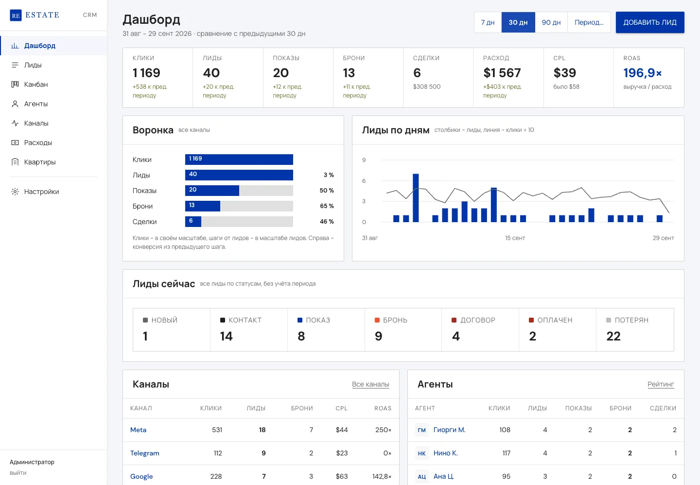
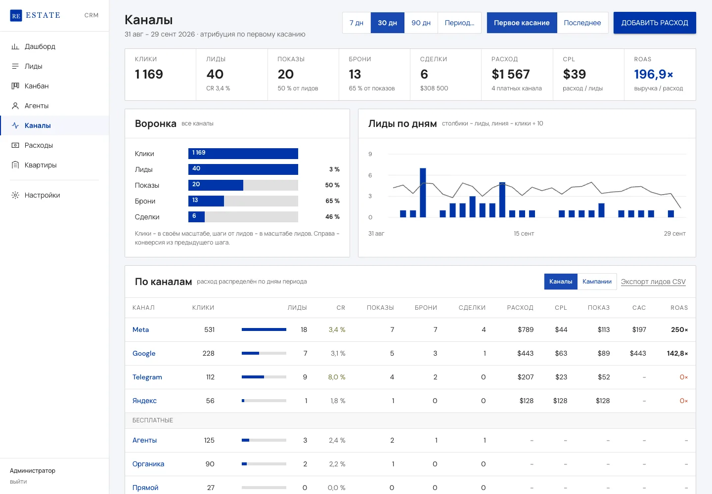
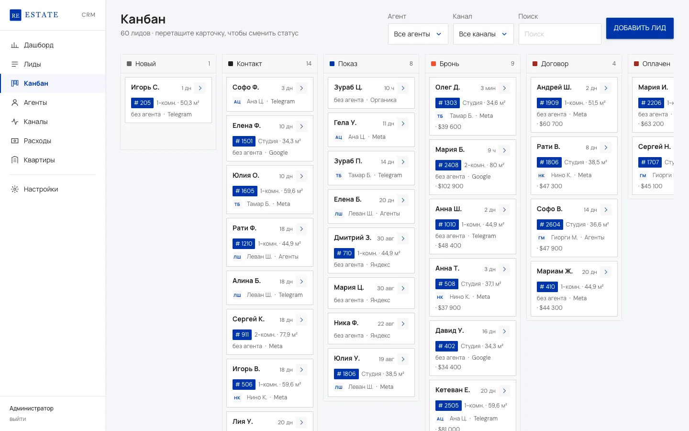
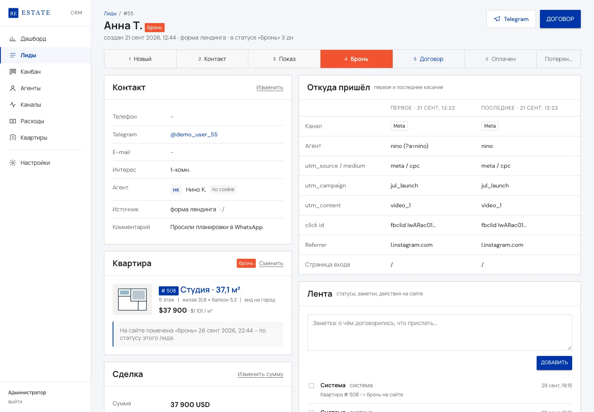

# realestate-crm

Sales CRM for a new-build residential tower: agent links, ad attribution, leads, and unit statuses synced to the sales site.

History: this is a public snapshot of a private repository (15 commits, 6 to 27 Sep 2026). Client details are replaced.

Built for the sales team of a 26-floor, 279-apartment residential tower in Georgia. It shows which agent and which ad channel brought each lead, and what each lead, showing and deal cost.



## What it does

- **Agent referral links.** Each agent gets a short link `/a/<slug>`. A visitor who arrives through it is bound to that agent for 90 days (first touch); later visits without the link still credit the same agent.
- **Channel attribution.** utm tags, ad click ids (`fbclid`, `gclid`, `ttclid`, `yclid`) and referrer map each visit to a channel through editable rules. Every lead stores both first and last touch; reports switch between them.
- **Lead dedupe.** Phone normalized to E.164, or Telegram handle. A repeat request within 30 days becomes a timeline entry on the existing lead, not a new lead.
- **Unit state machine synced to the site.** Lead to `booking` reserves the unit, `contract` / `paid` mark it sold, a lost booking frees it. The sales site reads `/api/units/status.json` (60 s cache). A unit held by one lead cannot be booked by another (409).
- **Spend and unit economics.** Expenses are spread per day over their period, so any date range gets a proportional share. CPL, cost per showing, CAC and ROAS per channel and per campaign.
- **Roles.** Admin, read-only viewer, and agents. Agents log in by magic link (no password), see only their own leads and their rank against the team median.
- **Notifications.** Telegram bot (token set from the UI, chats linked with `/start <code>`) and SMTP e-mail.
- **Operations without the developer.** CSV import for leads, expenses and prices; database copies, download and restore from the UI; full JSON export; a diagnostics panel in Settings; an audit log; one-command install on a clean Ubuntu server.

| Channels, first vs last touch | Kanban | Lead card with attribution |
|---|---|---|
|  |  |  |

The UI is in Russian, the language of the sales team. Screenshots show data generated by `npm run seed`.

## Technical decisions

- **Architecture.** One Node.js process (Fastify 5) and one SQLite file (better-sqlite3, WAL). About 1,660 lines of server code, 87 HTTP routes in 5 route files. The front end is static HTML and vanilla JS (about 1,070 lines) on design tokens, no build step. In production it runs under `/crm` on the sales site's domain, so the tracking cookie and the API share one origin. It can also run on its own subdomain; then CORS admits only `SITE_ORIGIN`. Reasons and rejected options (Twenty, EspoCRM, SuiteCRM, Mautic) are in [docs/DECISIONS.md](docs/DECISIONS.md).
- **Data model.** 22 tables. A `touch` is a visit with new entry parameters, a new visitor, or a 30-minute gap. Report counts for showings, bookings and deals come from `lead_status_history` by transition date, not by lead creation date, so a lead created in August and booked in September counts as a September booking. Details: [docs/DATA-MODEL.md](docs/DATA-MODEL.md).
- **Tracking snippet.** `crm-track.js`, about 5 KB (2.2 KB gzipped), no dependencies, one `<script>` line on the site. Keeps the visitor id in a cookie with a localStorage fallback, sends touches with `keepalive`, reports unit views from the unit-selection page, and exposes `crmTrack.lead()` for the site forms.
- **Hard parts.**
  - Attribution when an agent runs their own ads: a Meta ad with `?a=nino&utm_source=meta` credits both the agent and the Meta campaign.
  - Double booking: the unit state and the lead status change in one SQLite transaction; a second booking of the same unit returns 409 with the holding lead id.
  - Restore from the UI: the uploaded file passes `PRAGMA integrity_check`, is written next to the database as `<db>.restore`, the process exits, systemd restarts it, and the swap happens before the database opens.
  - Postbacks to Meta CAPI and Google offline conversions are queued with hashed phones and first-touch click ids; sending is stubbed (see Status).
- **Security defaults.** bcrypt passwords, magic-link tokens stored as SHA-256 hashes, 256-bit random session ids in httpOnly cookies, rate limits on login (5/min) and public lead intake (5/min per IP), a honeypot field, CORS in production limited to the site origin and the CRM's own origin. With `NODE_ENV=production` the server refuses to start if `ADMIN_PASSWORD` or `SESSION_SECRET` is missing, a placeholder, or the secret is under 32 characters; the `admin` / `admin` fallback exists only in development.
- **Tests.** `npm test` boots the server on a throwaway database, seeds 60 demo leads and about 1,800 touches, and runs `tools/e2e.sh` through the HTTP API: agent link click from a Meta ad, touch, unit view, lead from the site, contact, showing, booking, unit reported as `reserved` to the site, and both dashboards for today. It then checks dedupe and the production fail-fast. There are no unit tests; the end-to-end script was the acceptance gate for each release, run against local and production.
- **Harness.** Written with Claude Code: all 15 commits of the source repository carry a `Co-Authored-By: Claude` trailer. By git timestamps, the first commit (schema, API contract, decisions, 3 mockups) landed on 6 Sep 2026 at 17:15, the first production deploy at 18:18, and v0.2 (users and roles, bot and SMTP from settings, price list, backups, diagnostics, installer) at 19:56, 2 h 41 min after the first commit.

API reference: [docs/API.md](docs/API.md). Server install: [docs/INSTALL.md](docs/INSTALL.md). Operating manual for the sales office (Russian): [docs/OPERATIONS.ru.md](docs/OPERATIONS.ru.md).

## Stack

Node.js 22+, Fastify 5, better-sqlite3, bcryptjs, csv-parse, nodemailer. Vanilla JS and CSS custom properties on the front end. nginx and systemd in production. Bash, curl and python3 for the end-to-end test.

## Run locally

Requires Node.js 22 or newer (better-sqlite3 12 ships prebuilt binaries for Node 22, 24, 25 and 26).

```bash
npm ci
npm run seed        # demo data: 5 agents, 60 leads, 6 expense rows, about 1,800 touches
npm start           # http://127.0.0.1:3080/crm/admin/login.html  login admin, password admin
npm test            # separate throwaway database on port 3099
```

No `.env` is needed for local use. To change the port, paths or site URL, copy `.env.example` to `.env`. Telegram and e-mail stay off until a bot token or SMTP server is set. The only outbound requests are Google Fonts in the browser and the Settings diagnostics check of SITE_URL.

Agent cabinet: Агенты > the agent's "ссылки" button > "Выпустить ссылку входа" (issue login link), then open the link shown in the dialog (valid 7 days).

## Status

Client project, v0.2. Runs on a staging server with demo data.

Done: everything listed above.

Not done:
- Postback delivery to Meta CAPI, Google offline conversions and Telegram Ads. The queue, payload preview and retry exist; the network call is a stub; rows are marked `skipped` while a provider is off and `failed` (sender not implemented) when it is on.
- Per-agent contact details on the sales site for visitors who came through an agent link.
- Unit tests. Coverage is the end-to-end script only.
- Currency rates are entered by hand.

## History

This repository is a snapshot published without its commit history, because the history holds client correspondence. The private source repository has 15 commits from 6 Sep 2026 to 27 Sep 2026. Client-specific details (project name, legal entity, cadastre and permit numbers, address, building figures, domains, server addresses) are replaced with placeholders or removed.

## License

MIT, see [LICENSE](LICENSE). Copyright (c) 2026 Lev Skorokhodov.
