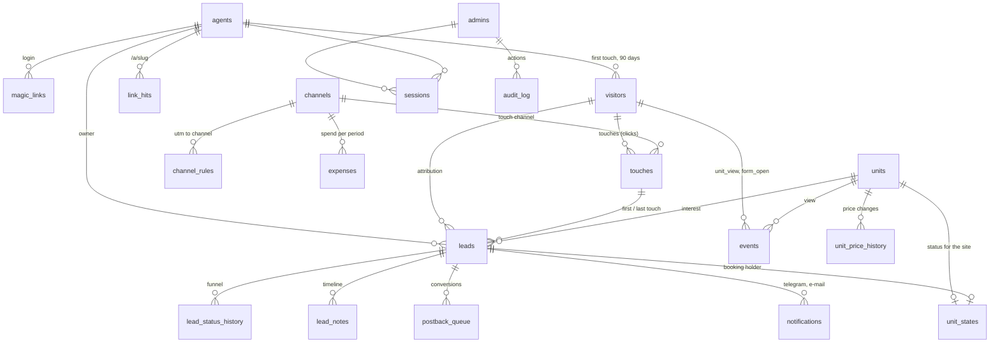

# Data model

DDL: `db/schema.sql` (22 tables, SQLite, WAL mode). Below: meaning and relations.



## Entities

| Table | What it is | Key fields |
|---|---|---|
| `agents` | sales agent | `slug` (link), `telegram_chat_id` (notifications), `is_active` |
| `magic_links`, `sessions`, `admins` | access | token stored as a hash; session in a cookie; `admins.role` is `admin` or `viewer` |
| `visitors` | a visitor's browser | `agent_id` is frozen on the first `a=` for 90 days |
| `touches` | **click** = a session with entry parameters | utm_*, click ids, referrer, `agent_slug`, computed `channel_id` |
| `events` | actions on the site | `unit_view` per unit, `form_open` |
| `link_hits` | hits on `/a/<slug>` | short-link monitoring |
| `channels`, `channel_rules` | taxonomy and mapping rules | seeded from `config/channels.json`, edited in settings |
| `units`, `unit_states` | units from `units.json` and the status override | `unit_states.status` goes to the site |
| `unit_price_history` | price edits | who, when, old and new price |
| `leads` | lead | `status`, `agent_id`, `channel_first_id` / `channel_last_id`, `deal_amount_usd`, `dedupe_key` |
| `lead_status_history` | status transitions | **source for counting showings, bookings and deals in a period** |
| `lead_notes` | timeline of notes and system entries | `kind`: note / system / duplicate |
| `expenses` | spend per channel for a period | `amount_usd` at the rate entered |
| `postback_queue` | server-side conversion queue | phase 1: stored and viewable, not sent |
| `notifications` | Telegram and e-mail log | for "it never arrived" debugging |
| `imports` | CSV import journal | import rollback |
| `audit_log` | admin actions | who changed what |
| `settings` | key-value | `attribution`, `fx.*`, `revenue_statuses`, `cookie_days`, bot token, SMTP |

## Funnel

```
new -> contact -> showing -> booking -> contract -> paid
  any status -> lost (lost_reason required)
```

| Report step | How it is counted for a period |
|---|---|
| Clicks | `touches` with `ts` in the period (per channel by `channel_id`, per agent by `agent_id`) |
| Leads | `leads.created_at` in the period |
| Showings | `lead_status_history.to_status='showing'` in the period (first transition per lead) |
| Bookings | `to_status='booking'` |
| Deals | `to_status IN ('contract','paid')`, each lead counted once |
| Revenue | `SUM(deal_amount_usd)` over leads in `settings.revenue_statuses` |

Step conversion = next step / previous step. Clicks to leads uses touches and leads of the same channel or agent; the remaining steps use leads.

Spend is spread evenly over the days of its period, so any date range takes a proportional share: $900 entered for September counts as $210 in a 7-day report.

## Unit status rules

| Lead transition | Unit |
|---|---|
| to `booking` | `reserved` (409 if already `reserved` / `sold` by another lead) |
| to `contract` / `paid` | `sold` |
| `booking` to `lost` | `available`, if this lead holds it |
| `contract` / `paid` to `lost` | unchanged, the admin decides by hand |

## Cookies on the site

| Cookie | Lifetime | Content |
|---|---|---|
| `crm_vid` | 90 days | visitor id |
| `crm_a` | 90 days | first-touch agent slug; never overwritten while alive |

## Demo data

The seed marks every row `is_demo=1`: 5 agents with made-up names and synthetic phones `+995 555 000 001` to `005`, 4 paid channels (meta, google, telegram, yandex) plus agent / organic / direct, 60 leads over the last 45 days with a plausible funnel, 6 expense rows, about 1,800 touches and matching events. "Delete demo data" in settings removes all of it at once.
